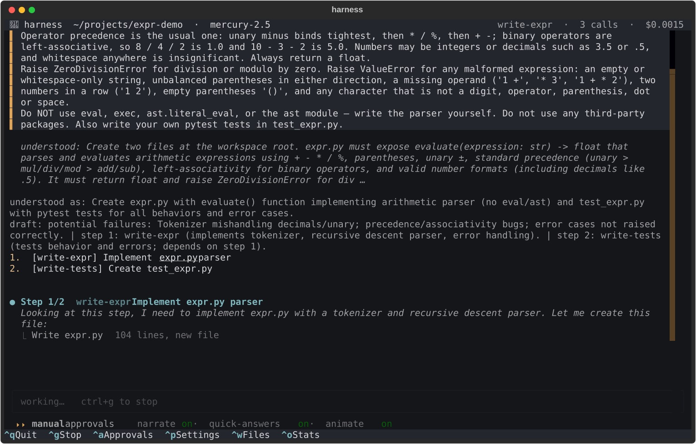
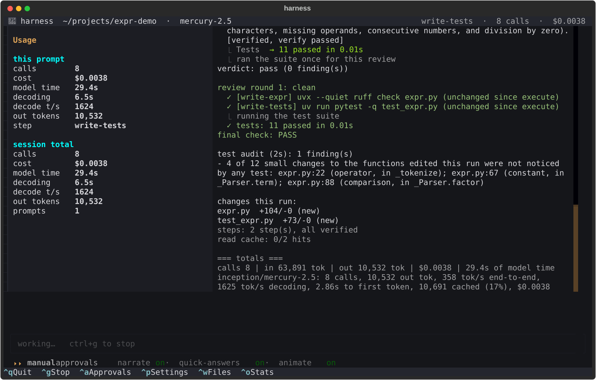
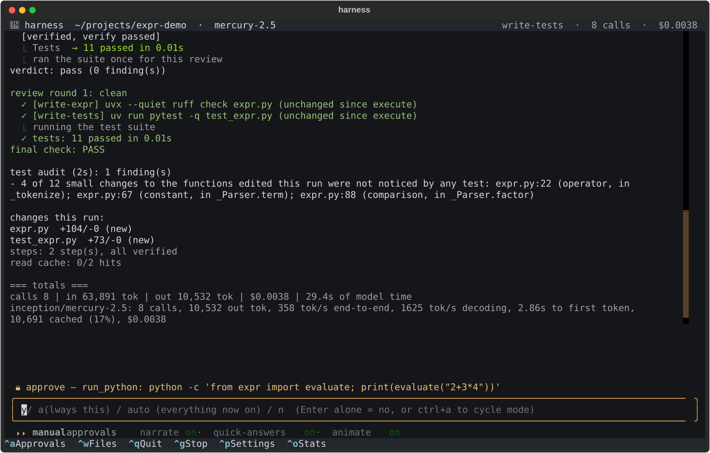
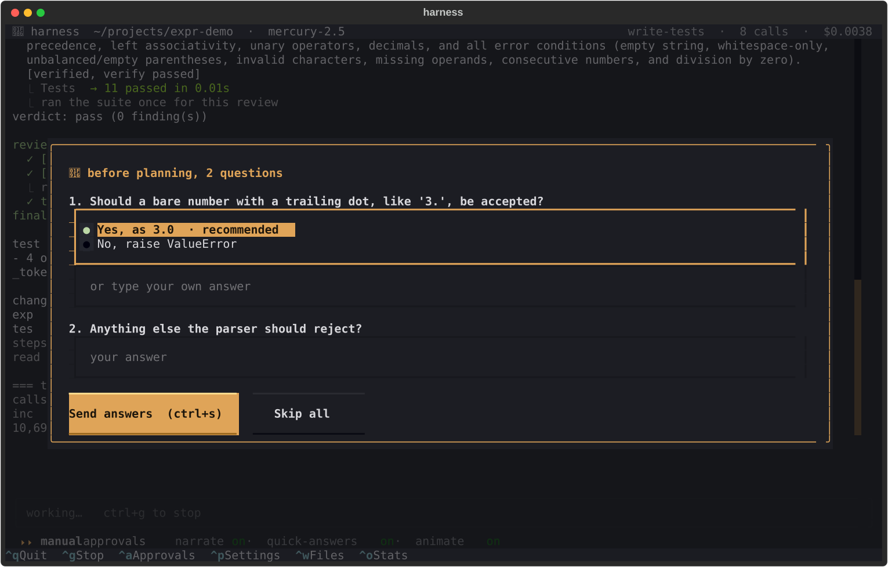
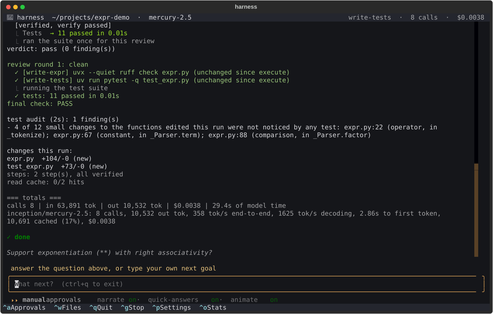
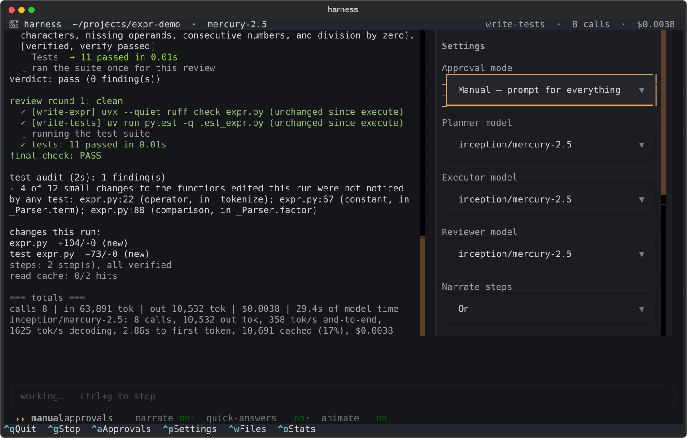
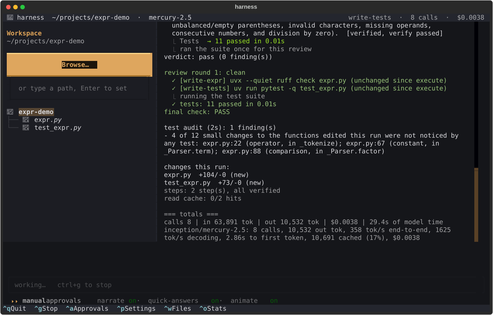

# The dashboard (`harness-tui`)

The dashboard is a terminal app for watching a run as it happens and answering it when it asks
you something. It runs exactly the same agent as `harness run`; it is a way of watching a run,
not a different kind of run, so every flag in {doc}`cli` works with it.

The screenshots on this page are the dashboard's own rendering of a recorded run (the expression
parser task from the benchmark's seeded projects), replayed without a model call by
`scripts/docs_tui_screenshots.py`.

## Install and start

The dashboard needs the `tui` extra:

```bash
uv tool install 'mercury-harness[tui] @ git+https://github.com/whtowbin/mercury-harness'
```

Then start it in a workspace, with or without a goal:

```bash
harness-tui -w ~/agent-sandbox                      # asks: "What should the agent build?"
harness-tui -w ~/agent-sandbox "build a CLI todo list with JSON persistence and pytest tests"
harness run -w ~/agent-sandbox --tui "same thing"   # the same dashboard from harness run
```

Type the goal in the box at the bottom and press <kbd>Enter</kbd>; <kbd>shift+Enter</kbd> starts
a new line. The same safety rules apply as on the command line: use a workspace outside any
Python project ({doc}`safety`).

## Following a run



The screen has five parts, top to bottom:

- **The top bar**: the workspace and the model on the left; on the right, the step being worked
  on, the number of model calls so far and the cost so far.
- **The transcript**: the goal, what the planner understood, the plan as numbered steps, then
  each step as it runs: the files it writes or edits, the tests it runs and whether its check
  passed. The final check and a summary of the changes come at the end.
- **A wait indicator**, shown while a model call is in flight.
- **The bar**: where you type a goal, an answer or an approval. While the agent works it reads
  "working… ctrl+g to stop".
- **The mode line and shortcuts**: the current approval mode and settings, and the keys that
  work at any moment (they are also clickable).

<kbd>ctrl+o</kbd> opens the **usage panel**: calls, cost, model time, decoding speed and output
tokens, for the current prompt and for the whole session.



## When the agent needs you

How often the agent stops to ask depends on the **approval mode**, shown on the mode line.
<kbd>ctrl+a</kbd> cycles through the three:

| mode | the agent asks before |
|---|---|
| `manual` (the default) | everything that runs code or a shell command |
| `auto-python` | shell commands, but not `run_python` |
| `auto-plan` | nothing, once a plan exists |

An approval appears above the bar, with the command it wants to run. Answer `y` to allow it once,
`a` to always allow it, `auto` to stop asking for anything, or `n` to refuse; pressing <kbd>Enter</kbd> on an empty bar also refuses. The terminal bell rings and a
notice appears when the agent starts waiting, so you notice it from another window.



Questions come in two forms. A free-text question appears above the bar like an approval. A
question with options, or the short set of questions the agent can ask before it plans (when
"Clarify before planning" is on), opens a form: pick an option or type your own answer, then
<kbd>ctrl+s</kbd> to send or <kbd>Escape</kbd> to skip.



## When a run ends

The transcript ends with **✓ done**, or with a list of what failed and **⚠ finished with
failures** if a step failed its check or the final check did not pass. The agent may suggest a
next step; it is shown as a question, not filled in, so the next goal is always yours. Type it in
the bar to continue in the same workspace, or press <kbd>ctrl+q</kbd> to quit.



## Settings and files

<kbd>ctrl+p</kbd> opens the **settings panel**: the approval mode, the planner, executor and
reviewer models, and switches for narrating steps, the wait animation, quick answers, clarifying
before planning, reviewing the plan before running, and the final check. A change made during a
run applies from the next run: the current one already has its plan and context built.



<kbd>ctrl+w</kbd> opens the **workspace panel** on the left: the folder the agent works in, as a
file tree. Choose another folder with **Browse…** or by typing a path.



## Keys

| key | does |
|---|---|
| <kbd>Enter</kbd> / <kbd>shift+Enter</kbd> | send the bar / new line in the bar |
| <kbd>ctrl+g</kbd> | stop the run |
| <kbd>ctrl+a</kbd> | cycle the approval mode: manual → auto-python → auto-plan |
| <kbd>ctrl+p</kbd> | settings panel |
| <kbd>ctrl+w</kbd> | workspace panel |
| <kbd>ctrl+o</kbd> | usage panel |
| <kbd>ctrl+q</kbd> | quit (asks first) |
| <kbd>ctrl+c</kbd> or <kbd>⌘C</kbd> | copy the selected text; selecting text also copies it |

The `ctrl` keys work whatever has focus. While the agent is working and the bar is not taking
input, the single letters <kbd>c</kbd> (stop), <kbd>s</kbd> (usage), <kbd>p</kbd> (settings),
<kbd>w</kbd> (workspace) and <kbd>q</kbd> (quit) work too; when the bar has focus, those letters
are typed into it instead.
